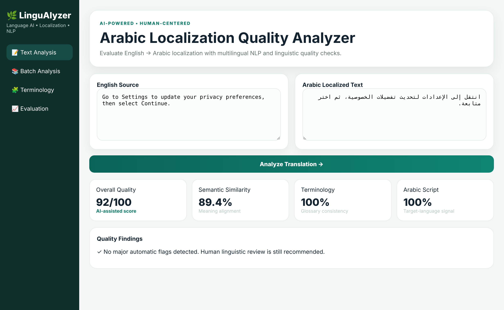

<div align="center">

# LinguAlyzer

**Language. Culture. Intelligence.**

Arabic localization quality analysis with multilingual NLP, and a research dataset on literal versus natural Arabic translation.


[Live demo](https://lingualyzer-j46qnmpej563zcfh79exbv.streamlit.app) ·
[Research: translation naturalness](naturalness) ·
[iOS app](https://github.com/ShahadA-lmutairi/LinguAlyzer-iOS)

</div>

---

## Overview

Arabic translations are often grammatical but still wrong for the product: a glossary term was changed, a `{name}` placeholder disappeared, a number doesn't match, or the sentence reads like a word-for-word copy of the English. LinguAlyzer checks an English source against its Arabic translation, flags these problems with a short reason, and leaves the final judgment to a human reviewer.

The project has two parts:

| Part | What it is |
|---|---|
| **[Analyzer](LinguAlyzer_Final_Polished)** | A Streamlit web app that scores a translation using multilingual sentence embeddings and rule-based checks, one pair at a time or a whole CSV. |
| **[Naturalness research](naturalness)** | A dataset and benchmark for detecting and repairing literal Arabic translations («قام المستخدم بتحديث» → «حدّث المستخدم»), with annotation guidelines, baselines and an AraBERT notebook. |

<div align="center">
  <a href="docs/web-preview.png"></a>
  <br>
  <sub><i>Interface preview of the web app. <a href="https://lingualyzer-j46qnmpej563zcfh79exbv.streamlit.app">Try the live demo</a>.</i></sub>
</div>

## Analyzer

### What it checks

| Check | Method |
|---|---|
| **Meaning** | Cosine similarity between English and Arabic sentence embeddings (`paraphrase-multilingual-MiniLM-L12-v2`) |
| **Terminology** | English glossary terms in the source must appear with their approved Arabic term |
| **Placeholders** | `{name}`, `%s`, `${var}` and `<tag>` tokens must match |
| **Numbers** | Numbers must match between source and target |
| **Script** | Share of Arabic letters, to catch untranslated text |
| **Length** | Target/source length ratio outside the usual range |

**Batch mode:** upload a CSV of source and target pairs, get a score and findings for every row, and download the results.

### Score

The overall score is a weighted combination of the checks:

| Component | Weight |
|---|---|
| Semantic similarity | 50% |
| Terminology | 18% |
| Arabic script share | 10% |
| Placeholders | 8% |
| Length ratio | 7% |
| Numbers | 7% |

> [!NOTE]
> The score is a screening indicator, not a measure of translation quality. It does not judge tone, register, dialect or cultural fit. A qualified reviewer makes the final decision.

## Research: Arabic translation naturalness

> **Can a model tell a literal Arabic translation from natural Arabic, and fix it?**

The [`naturalness`](naturalness) folder builds a dataset of English UI strings, each with a literal and a natural Arabic translation and the pattern behind the literal one (قام بـ، تم/يتم، بواسطة، الخاص بك، and others). Models are evaluated with grouped cross-validation so the two sides of a pair never leak across folds.

| Model | Status |
|---|---|
| Rule-based patterns | ✅ Baseline |
| TF-IDF character n-grams + logistic regression | ✅ Baseline |
| AraBERT fine-tuned | 📓 Colab notebook ready |
| Large language models (detection and repair) | 🔜 Planned |

Current numbers and how to reproduce them: [`naturalness/results/baseline.md`](naturalness/results/baseline.md). The dataset is at an early stage (seed data under review); see the [annotation guidelines](naturalness/GUIDELINES.md).

## Run locally

```bash
git clone https://github.com/ShahadA-lmutairi/LinguAlyzer.git
cd LinguAlyzer

# Web app
cd LinguAlyzer_Final_Polished
pip install -r requirements.txt
streamlit run app.py

# Research baselines
cd ../naturalness
pip install -r requirements.txt
python validate.py
python baseline.py
```

## Repository structure

```
LinguAlyzer/
├── LinguAlyzer_Final_Polished/   Streamlit web app
│   ├── app.py
│   └── requirements.txt
├── naturalness/                  Research: literal vs natural Arabic
│   ├── data/pairs.csv            Dataset
│   ├── GUIDELINES.md             Annotation guidelines
│   ├── baseline.py               Rules and TF-IDF baselines
│   ├── validate.py               Dataset checks
│   ├── notebooks/                AraBERT fine-tuning (Colab)
│   └── results/                  Reported numbers
└── docs/                         Images
```

## Related

- **[LinguAlyzer for iOS](https://github.com/ShahadA-lmutairi/LinguAlyzer-iOS)**: the same review workflow as a native SwiftUI app for iPhone and iPad, with on-device Arabic NLP using Apple's NaturalLanguage framework.

## Roadmap

- [ ] Grow the naturalness dataset to 500+ reviewed pairs from real app strings
- [ ] AraBERT and CAMeLBERT results with error analysis
- [ ] LLM evaluation: detection and repair, zero-shot vs few-shot
- [ ] Publish the dataset on Hugging Face
- [ ] Add a naturalness check to the analyzer

## Author

**Shahad**, applied linguist (M.A. Applied Linguistics) working on Arabic NLP, localization and data. Trained in corpus linguistics (Lancaster University) and digital content localization (Middlebury Institute).
